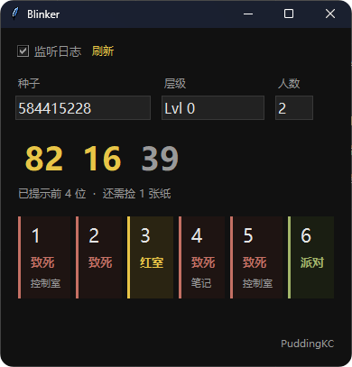

# Blinker

**Blinker** 是一款用于 VRChat 地图 **The BackroomsVR** 的辅助工具。  
程序会自动读取 VRChat 日志中的关卡种子，并通过特定算法计算控制室密码和六个坑位对应的结果，帮助玩家快速获取关卡信息。

<p align="center">
  
</p>

## 功能特性

- 无需命令行操作，启动后即可使用。
- 持续跟踪最新的 VRChat 日志，检测到新的开局记录后，自动更新种子、关卡和玩家人数。
- 种子、关卡和人数均可手动调整。修改后会暂停自动跟踪，点击 `刷新` 即可重新读取日志。
- 显示六位控制室密码，分为三组。亮色数字表示键盘上已提供的提示，暗色数字需要通过拾取纸条获取。
- 分别标记六个坑位的结果，包括派对房、红室或混乱，以及致死坑。对于致死坑，还会标明由笔记和控制室分别提示的坑位。

## 运行原理

程序从以下目录读取 VRChat 日志：`%USERPROFILE%\AppData\LocalLow\VRChat\VRChat\`  
启动后，程序会定位最新的 output_log_*.txt 文件，并从文件末尾向前查找最近一次关卡激活记录，例如：

```text
[LevelActivator:Lvl 0] Activate seed=1893789332
[LevelActivator:Lvl 0] players=1
```

程序根据记录中的种子、关卡名称和玩家人数更新计算结果，并定期检查日志文件是否发生变化。

## 免责声明

Blinker 是一款由社区开发的第三方辅助工具，与 VRChat 及 The BackroomsVR 地图的开发者无关，也不代表其立场。

本软件仅用于读取本地日志并辅助分析游戏信息。使用者应自行承担使用本软件所产生的风险，并遵守 VRChat 的服务条款及相关游戏规则。请勿将本软件用于破坏其他玩家的正常游戏体验或其他违规用途。

本软件按 **现状** 提供，不对计算结果的准确性、完整性或可用性作出任何明示或暗示的保证。因使用或无法使用本软件而产生的任何损失，开发者不承担相关责任。
